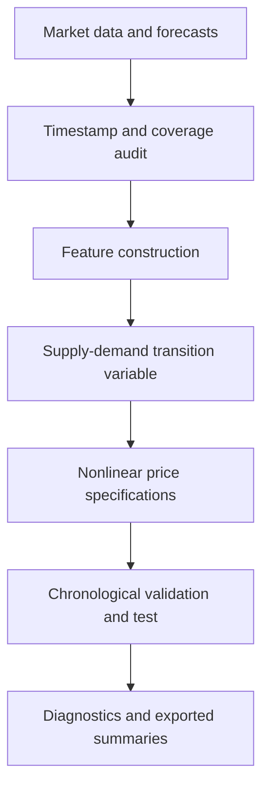

# Structural Non-Linearity and Negative Electricity Prices

**Research project · Applied statistics · European wholesale electricity markets**

This repository studies nonlinear dynamics in Day-Ahead electricity prices, with particular attention to negative-price episodes and the relationship between market prices and supply-demand conditions.

The project is part of a broader research programme at the intersection of applied mathematics, statistical modelling and energy-market analysis. It is an empirical research codebase, not a trading system.

## Research objectives

1. Characterise nonlinear price responses across different supply-demand conditions.
2. Examine whether negative-price episodes are associated with distinct market regimes.
3. Compare model behaviour across France, Germany/Luxembourg and Spain.
4. Assess the stability and interpretability of estimated transition thresholds.

## Methodological overview

The country notebooks implement smooth-transition specifications, including an exponential form and a logistic (LSTAR-type) form. The transition variable is built from market fundamentals and an estimated supply-demand balance. Price dynamics are represented through lagged prices at several horizons.

The empirical workflow combines:

- temporal alignment and data-quality checks;
- construction of market and calendar variables;
- an instrumentation / prediction stage for selected physical fundamentals;
- nonlinear parameter estimation;
- chronological estimation, validation and test periods;
- diagnostic plots, event-frequency analysis and exported summaries.

The implementation and specification are still evolving. Consult the notebook configuration and the [methodology notes](docs/METHODOLOGY.md) before interpreting any estimate.

## Repository structure

```text
.
├── README.md
├── CITATION.cff
├── requirements.txt
├── .gitignore
├── docs/
│   ├── ARCHITECTURE.md
│   ├── METHODOLOGY.md
│   └── REPRODUCIBILITY.md
└── Structural/
    └── data/
        ├── DE_LU.csv
        ├── ES.csv
        ├── FR.csv
        └── notebooks/
            ├── 01_France.ipynb
            ├── 03_Allemagne_DE_LU.ipynb
            └── 04_Espagne_ES.ipynb
```

The current implementation is notebook-centred: data preparation, model functions and estimation routines are embedded in the notebooks. A modular `src/` package and automated tests have not yet been introduced.

## Empirical scope

| Market | Notebook configuration | Current evaluation window |
|---|---|---|
| France | Legacy exploratory workflow using a local historical CSV | Defined in the notebook |
| Germany / Luxembourg | ENTSO-E by default; Energy-Charts alternative | 2024 |
| Spain | ENTSO-E by default; Energy-Charts alternative | 2025 |

The exact dates, thresholds, data-source switches and bootstrap settings are defined in each notebook. They should be checked before reproducing or comparing results.

## Workflow



## Installation

Python 3.11 or later is a practical starting point. The exact environment has not yet been locked to a tested dependency snapshot.

```bash
python -m venv .venv
```

Activate the environment, then install the dependencies:

**Windows PowerShell**
```powershell
.\.venv\Scripts\Activate.ps1
python -m pip install --upgrade pip
python -m pip install -r requirements.txt
```

**macOS / Linux**
```bash
source .venv/bin/activate
python -m pip install --upgrade pip
python -m pip install -r requirements.txt
```

## Data access and credentials

The Germany/Luxembourg and Spain notebooks use the ENTSO-E Transparency Platform by default. Set the API token as an environment variable before launching Jupyter:

**Windows PowerShell**
```powershell
$env:ENTSOE_TOKEN = "your_token"
```

**macOS / Linux**
```bash
export ENTSOE_TOKEN="your_token"
```

Never commit API tokens, private datasets or company-confidential information. The notebooks also contain an Energy-Charts alternative; source availability and coverage must be checked for each market.

The France notebook now reads its input path from the `FRANCE_DATA_PATH` environment variable. By default it expects `data/historique_2015_2024.csv` relative to the working directory. The historical France CSV is not included in this repository; point the variable to your authorised local copy.

## Running the notebooks

From the repository root:

```bash
jupyter lab
```

Open the notebooks under `Structural/data/notebooks/` and run the relevant cells in order. The country notebooks create local cache CSV files and export model summaries / diagnostic figures in the working directory. The exact output filenames are defined in the notebook code.

See [Reproducibility and current limitations](docs/REPRODUCIBILITY.md) for important details before running the full workflow.

## Results and figures

The notebooks contain code for diagnostic visualisations and exportable model summaries. A verified set of final figures and numerical test metrics is not yet curated in this repository; results are therefore not reported here as headline performance claims.

Once the empirical runs have been audited, the repository should include a small set of versioned figures with captions, market, evaluation period, benchmark and data provenance.

## Important limitations

- The code is currently organised in notebooks rather than tested Python modules.
- The France notebook contains a local absolute file path and a distinct legacy workflow.
- Data cleaning choices (including treatment of missing hours and high prices) can affect the analysis of rare price observations and must be justified for the final research version.
- The notebooks' time information sets and lag definitions should be checked against the intended Day-Ahead forecast cut-off before describing a result as operationally leak-free.
- Dependency versions and a complete run log are not yet pinned.

## Author

**Anoune Mergane**  
PhD researcher in Applied Mathematics (CIFRE) — stochastic modelling, statistical inference and electricity-market applications.

[GitHub profile](https://github.com/Anoune1946)
