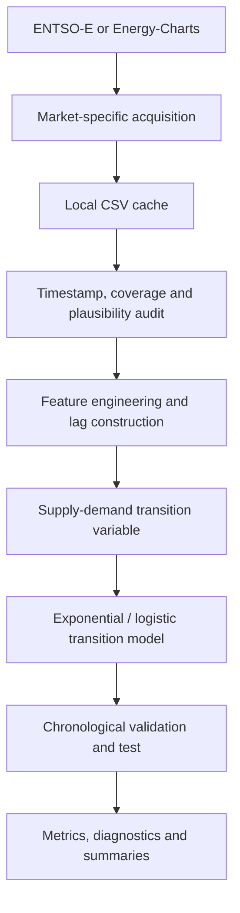

# Codebase architecture

## Current implementation

The repository is currently organised around Jupyter notebooks. The country-specific notebooks contain their own configuration, data acquisition logic, preparation functions, model routines, diagnostics and result exports.

```text
repository/
├── README.md
├── requirements.txt
├── CITATION.cff
├── docs/
│   ├── ARCHITECTURE.md
│   ├── METHODOLOGY.md
│   └── REPRODUCIBILITY.md
└── Structural/
    └── data/
        ├── FR.csv
        ├── DE_LU.csv
        ├── ES.csv
        └── notebooks/
            ├── 01_France.ipynb
            ├── 03_Allemagne_DE_LU.ipynb
            └── 04_Espagne_ES.ipynb
```

The France notebook is a legacy exploratory workflow with its own preprocessing and model implementation. The Germany/Luxembourg and Spain notebooks share a more standardised workflow, but currently duplicate substantial portions of their functions.

## Current data and modelling flow



The France workflow starts from a separate local historical CSV selected through FRANCE_DATA_PATH. It should not be assumed to be a drop-in implementation of the other country notebooks.

## Proposed modular target

A future refactor should extract shared routines while preserving notebook outputs and scientific results:

```text
src/
├── config/
│   ├── markets.py
│   └── settings.py
├── data/
│   ├── entsoe.py
│   ├── energy_charts.py
│   └── validation.py
├── features/
│   ├── calendar.py
│   ├── lags.py
│   └── balance.py
├── models/
│   ├── transitions.py
│   ├── estimation.py
│   └── bootstrap.py
└── evaluation/
    ├── metrics.py
    ├── diagnostics.py
    └── plots.py

notebooks/
├── 01_france.ipynb
├── 02_germany_luxembourg.ipynb
└── 03_spain.ipynb

tests/
├── test_time_alignment.py
├── test_dst_handling.py
├── test_features.py
└── test_model_shapes.py
```

This is a target design, not the current on-disk structure. It should be implemented incrementally with regression tests, not by moving notebook cells wholesale.

## Recommended refactoring order

1. **Configuration:** move market zones, time zones, sample windows, event thresholds and data-source options into explicit configuration files.
2. **Data acquisition:** centralise ENTSO-E and Energy-Charts retrieval, retries, cache keys and source metadata.
3. **Data validation:** add tests for duplicate timestamps, daylight-saving transitions, missing hours, units and sign conventions.
4. **Features:** isolate lag construction, forecast-origin checks and the transition variable.
5. **Models:** extract shared exponential/logistic model functions, estimation and bootstrap routines.
6. **Evaluation:** centralise chronological splits, benchmark metrics, event diagnostics and figure export.
7. **Notebooks:** reduce each notebook to a readable orchestration layer that calls tested modules.

## Scientific safeguards

The refactor must preserve the declared information set and the chronological train/validation/test split. In particular, changing how timestamps, physical forecasts or the last available Day-Ahead price are aligned may change the scientific experiment. Such changes require explicit tests and a new recorded run.